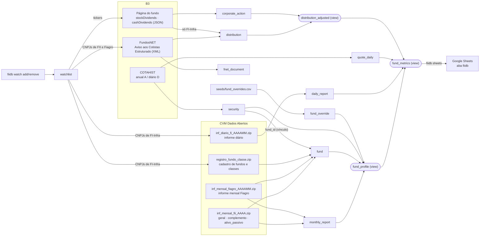
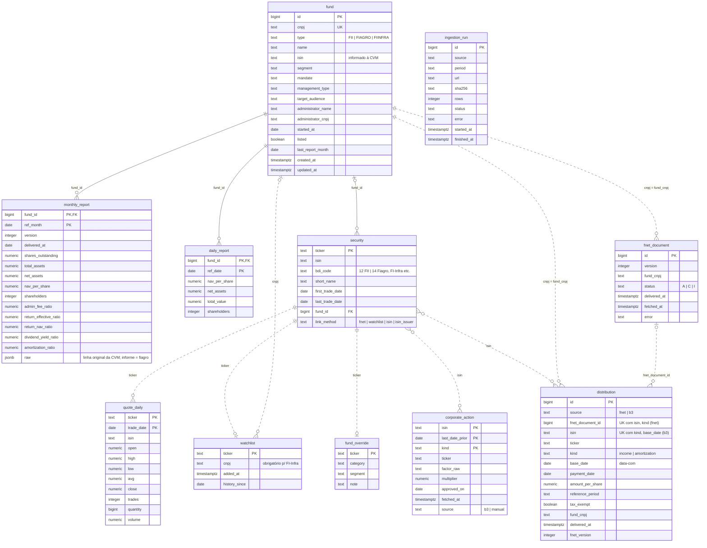

# Ingestão de dados

Como os dados chegam ao Postgres: fontes, tabelas, fluxo do `catch-up` e as armadilhas conhecidas de cada fonte.
O escopo atual é **FII** e **Fiagro** (todos) e **FI-Infra** (só os da watchlist); `fund.type` diz qual é qual.

## Visão geral

## Fontes → tabelas

| Tabela | Fonte | Conteúdo | Chave |
|---|---|---|---|
| `fund` | CVM, CSV `geral` (FII); informe mensal Fiagro; cadastro `registro_classe` (FI-Infra da watchlist) | Cadastro: CNPJ, tipo, nome, ISIN informado, segmento declarado, administrador | `cnpj` |
| `monthly_report` | CVM, CSVs `complemento` + `ativo_passivo` (FII); informe mensal Fiagro (`raw.informe = 'fiagro'`) | PL, VP/cota, cotistas, rentabilidade, DY do mês; composição do ativo em `raw` | `(fund_id, ref_month)` |
| `daily_report` | CVM informe diário, só FI-Infra da watchlist | VP/cota, PL, valor da carteira, cotistas por dia | `(fund_id, ref_date)` |
| `security` | B3 COTAHIST (BDI 12 e 14) + vínculo calculado | Tickers negociados, ISIN, BDI, período de negociação, `fund_id` | `ticker` |
| `quote_daily` | B3 COTAHIST | OHLC, volume, nº de negócios por pregão (sem ajuste) | `(ticker, trade_date)` |
| `distribution` | FII e Fiagro: B3 FundosNET (`source = 'fnet'`); FI-Infra: página do fundo na B3, `cashDividends` (`source = 'b3'`). Só fundos da `watchlist` | Rendimentos e amortizações: data-com, pagamento, valor por cota | `fnet`: `(fnet_document_id, isin, kind)`; `b3`: `(isin, kind, base_date)` |
| `fnet_document` | B3 FundosNET (busca) | Avisos já processados: versão, situação (ativo/cancelado/inativo), erro | `id` |
| `watchlist` | você, via `fiidb watch` (fora do git) | Fundos cujos proventos são buscados; até quando o histórico está completo | `ticker` |
| `corporate_action` | B3, página do fundo (`stockDividends`), só watchlist | Desdobramentos, grupamentos e bonificações: data-com, fator | `(isin, last_date_prior, kind)` |
| `fund_override` | `seeds/fund_overrides.csv` (manual) | Correções de categoria/segmento por ticker | `ticker` |
| `corporate_action` (`source = 'manual'`) | `seeds/corporate_actions.csv` (manual) | Eventos que a B3 não lista e alertas revisados | `(isin, last_date_prior, kind)` |
| `ingestion_run` | o próprio pipeline | Um registro por arquivo processado (hash, status, linhas) | — |
| `fund_profile` (view) | calculada | Categoria e segmento de cada fundo | — |
| `distribution_adjusted` (view) | calculada | Proventos ativos, sem duplicatas, com valor por cota de hoje (ajustado por desdobramentos) | — |
| `fund_metrics` (view) | calculada | Uma linha por ticker: preço, VP/cota, P/VP, último rendimento, DY 12m, liquidez | — |

`watchlist` guarda fundos a acompanhar; para um FI-Infra, o `cnpj` informado é o que cria o fundo (ver
[FI-Infra](#fi-infra)).

Descrições por coluna ficam no próprio banco (`\d+ <tabela>` no psql).

### Modelo de dados

Linha cheia = foreign key no banco (só as três para `fund`); tracejada = junção lógica sem FK, proposital porque
as fontes chegam fora de ordem (cotação antes do fundo, provento de um ISIN de recibo que não está em `security`).
As views ficam de fora: dependências delas no diagrama de [Visão geral](#visão-geral). Atualize junto com as
migrações.

### URLs

| Fonte | URL | Atualização |
|---|---|---|
| CVM informe mensal | `https://dados.cvm.gov.br/dados/FII/DOC/INF_MENSAL/DADOS/inf_mensal_fii_{AAAA}.zip` | Semanal; os últimos ~5 anos são republicados com reenvios |
| COTAHIST anual | `https://bvmf.bmfbovespa.com.br/InstDados/SerHist/COTAHIST_A{AAAA}.ZIP` (~90 MB) | Diária durante o ano corrente |
| COTAHIST diário | `https://bvmf.bmfbovespa.com.br/InstDados/SerHist/COTAHIST_D{DDMMAAAA}.ZIP` (~400 KB) | Publicado à noite (~20h30) |
| CVM informe mensal Fiagro | `https://dados.cvm.gov.br/dados/FIAGRO/DOC/INF_MENSAL/DADOS/inf_mensal_fiagro_{AAAAMM}.zip` (≤ 75 KB) | Semanal; todos os meses são republicados |
| FundosNET busca | `https://fnet.bmfbovespa.com.br/fnet/publico/pesquisarGerenciadorDocumentosDados` (`idCategoriaDocumento=14`, `idTipoDocumento=41`, sem `tipoFundo`) | Contínua |
| FundosNET documento | `https://fnet.bmfbovespa.com.br/fnet/publico/downloadDocumento?id={id}` | — |
| B3 página do fundo | `https://sistemaswebb3-listados.b3.com.br/fundsProxy/fundsCall/GetListedSupplementFunds/{base64 de {"cnpj":"0","identifierFund":"HGLG","typeFund":7}}` (serve também para FI-Infra) | Contínua |
| CVM cadastro de fundos | `https://dados.cvm.gov.br/dados/FI/CAD/DADOS/registro_fundo_classe.zip` (~7 MB) | Diária |
| CVM informe diário | `https://dados.cvm.gov.br/dados/FI/DOC/INF_DIARIO/DADOS/inf_diario_fi_{AAAAMM}.zip` (~11 MB, todos os fundos do país) | Diária; o mês corrente e o anterior são republicados |

Os endpoints do FundosNET e da página do fundo na B3 não são APIs oficiais e podem mudar.

## Fluxo do `catch-up`

`uv run fiidb catch-up` é idempotente e pode rodar no boot e diariamente. Em ordem:

1. **CVM**: para cada ano de `FIIDB_START_YEAR` (padrão 2016) até o atual, baixa o zip (~1 MB) e compara o sha256
   com a última execução bem-sucedida em `ingestion_run`. Se mudou, recarrega o ano inteiro numa transação.
2. **CVM Fiagro**: para cada mês de 2025-05 (o primeiro publicado) até o atual, baixa o zip e recarrega o mês
   se o sha256 mudou. 404 = mês ainda não publicado.
3. **COTAHIST**:
   - anos fechados: arquivo anual, uma única vez (cacheado em `FIIDB_CACHE_DIR`, padrão `~/.cache/fiidb`);
   - ano corrente: arquivo anual na primeira vez, depois um arquivo diário por dia útil desde a última cotação.
     404 = feriado ou ainda não publicado (é tentado de novo na próxima execução).
   - Se o banco ainda não tem nenhum ticker BDI 14 (carregado antes do FI-Infra), recarrega todos os anos uma vez.
4. **FI-Infra** (só se houver algum na watchlist): cadastro da CVM e informe diário do mês corrente e do anterior,
   cada arquivo só quando o sha256 mudou.
5. **FundosNET**: o mesmo que `fiidb fnet-latest` (abaixo), incluindo os proventos de FI-Infra pela página da B3.
6. **Vínculo ticker → fundo** (`fiidb/linking.py`), detalhado abaixo.
7. **Seeds**: substitui `fund_override` e os eventos manuais de `corporate_action` pelo conteúdo dos CSVs.

Cada arquivo é uma transação própria (conexão em autocommit + `conn.transaction()`). Falhas são registradas em
`ingestion_run` com `status = 'error'`, os demais arquivos seguem, e o comando sai com código 1.

Primeira carga: ~1 GB de download e alguns minutos. Execuções seguintes: segundos. Banco completo: ~420 MB.

## Proventos (FundosNET)

O FundosNET é lento e instável: quando responde, leva menos de 1 s; quando falha, a requisição trava (ou volta
5xx). Por isso só os fundos da **`watchlist`** são consultados, um por vez, com timeout de 15 s e 4 tentativas
(`fnet.TIMEOUT`, `fnet.RETRIES`). A falha de um fundo não impede os outros; o próximo job tenta de novo.

| Fluxo | Comando | O que faz |
|---|---|---|
| Frequente | `fiidb fnet-latest` (também no `catch-up`) | Para cada fundo da lista, busca os 5 avisos mais recentes pelo CNPJ e baixa só os novos ou alterados. ~1 s por fundo |
| Ao adicionar | `fiidb watch add HGLG11 ...` | Inclui na lista e carrega os últimos 400 dias (o necessário para o DY 12m). `--no-history` pula a carga; `--cnpj` para ticker sem fundo vinculado |
| Ad hoc | `fiidb fnet-history HGLG11 [--since AAAA-MM-DD] [--force]` | Pagina todo o histórico (200 avisos por página). `--force` baixa de novo o que já foi processado (após corrigir o parser). ~30–50 s para um fundo com 10 anos |

Regras:

- A busca filtra por `cnpjFundo` **formatado** (`11.728.688/0001-47`); só dígitos dá erro 5xx.
- Uma reapresentação mantém o `id` do documento e incrementa a `versao`: `fnet_document` guarda (versão,
  situação), e o documento é baixado de novo quando algum dos dois muda.
- Documentos cancelados (`C`) ou inativos (`I`) têm seus proventos apagados.
- Um download que falha fica em `fnet_document.error` e é tentado de novo na próxima execução.
- `distribution.fund_cnpj` é o CNPJ usado na busca (o da CVM), não o escrito no XML.
- `watchlist.history_since` marca desde quando o histórico está completo (`1900-01-01` = tudo). Só é
  atualizado quando todas as páginas e documentos foram processados sem erro.
- A busca **não** filtra por `tipoFundo`: os avisos de um Fiagro estão em `tipoFundo=1` (FII) até ~set/2025 e em
  `tipoFundo=11` depois (ver [Fiagro](#fiagro)). CNPJ + categoria + tipo de documento já bastam.
- FI-Infra não passa pelo FundosNET (ver abaixo).

## Fiagro

Para o pipeline, um Fiagro é um FII com outro informe mensal: mesmas tabelas, mesmos proventos pelo FundosNET
(XML idêntico), mesmos desdobramentos pela página da B3. Todos os Fiagros da CVM são carregados (310 em set/2026,
de todos os tipos: imobiliário, direitos creditórios, participações); a maioria é de balcão, sem ticker.

| Dado | Fonte | Observação |
|---|---|---|
| Preço | COTAHIST, BDI 14 | 36 tickers `FIAGRO …` negociados em nov/2026. BTAL11 e BTRA11 continuam no BDI 12 |
| Cadastro, VP/cota, PL, cotistas | CVM `inf_mensal_fiagro_AAAAMM.zip` | Um zip por mês desde 2025-05. Só o CSV principal é lido (uma linha por classe, 133 colunas); o de subclasses é ignorado |
| Proventos | FundosNET | Como FII; só fundos da watchlist |

**Transição**: até ~ago/2025 os Fiagro-Imobiliário entregavam o informe mensal de FII, então a maioria já existia
em `fund` como `FII`, com histórico em `monthly_report`. Com o Anexo VI da RCVM 175 passaram ao informe próprio
(3 fundos em 2025-05, 125 em 2025-09, 310 em 2026-09). O CNPJ é o mesmo: ao aparecer no informe Fiagro com mês
igual ou posterior ao último informe FII, o fundo vira `type = 'FIAGRO'` e os informes continuam na mesma série.
`cvm_fii` não escreve `type`, então recarregar um ano antigo não desfaz a troca. Segmento e demais campos que só
existem no informe FII ficam como estavam.

**Meses nos dois informes**: 14 pares (fundo, mês) foram entregues nos dois. Vale sempre o do Fiagro, marcado com
`raw.informe = 'fiagro'`: ele sobrescreve a linha do FII seja qual for a versão, e o `cvm_fii` não mexe em linha
marcada. Um fundo cujo informe FII ainda é o mais recente guarda o informe Fiagro mas continua `FII`.

**Diferenças do arquivo**:

- Percentuais vêm em % (`Dividend_Yield_Mes = 1.09`), não em fração como no informe FII. São divididos por 100
  antes de gravar; em `raw` ficam como vieram.
- `Valor_Patrimonial_Cotas` tem só 2 casas (9.98). Quando `Patrimonio_Liquido / Cotas_Emitidas` arredonda para o
  valor informado, grava-se o quociente (9,98037235); senão, o informado. Fundos de balcão com "1 cota" (o VP é o
  PL inteiro) e VP ≤ 0 ficam com VP NULL (60 de 310 em set/2026), original em `raw`.
- ISIN em branco em ~40% das linhas; um ISIN em branco não apaga o que o fundo já tinha.

**Vínculo**: pelo ISIN, como FII, mas no BDI 14 só para fundos `FIAGRO` (o BDI 14 tem ETFs, FIPs e FIDCs). Dos 36
tickers negociados, 27 ligam por `isin` e 4 por `isin_issuer` (KNCA11 negocia como `BRKNCACTF006` e informa
`BRKNCACTF014`; RZEO11 informa o ISIN de um recibo). Ficam sem fundo os de ISIN ambíguo ou ausente: RURA11
(`BRRURAR01M16` em dois fundos), FZDA11 (`BRFZDACTF008` em dois), AAGR11, BRFT11, CTEM11. Para esses, use
`fiidb watch add TICKER --cnpj <cnpj>` **depois** de um `catch-up`: com o CNPJ já em `fund` como Fiagro, o comando
segue o fluxo do FundosNET; um CNPJ desconhecido num ticker BDI 14 é tratado como FI-Infra.

**Classificação**: categoria `Fiagro`, sem segmento (a composição do ativo fica em `raw`: `Imoveis_Rurais`, `CRA`,
`CPR`, `FIDC`…, para uma subdivisão futura em terras/crédito).

## FI-Infra

Fundos de debêntures incentivadas de infraestrutura (Lei 12.431) seguem as regras gerais de fundos (RCVM 175,
anexo I), não as de FII: nada de informe mensal FII nem de avisos no FundosNET (a busca pelo CNPJ do KDIF11 não
traz nada). As fontes são outras:

| Dado | Fonte | Observação |
|---|---|---|
| Preço | COTAHIST, BDI 14 | Junto com ETFs, FIPs, FIDCs e Fiagro (~310 tickers). Todos são carregados em `security`/`quote_daily`; só os vinculados a um fundo aparecem com dados |
| Cadastro | CVM `registro_fundo_classe.zip` | `registro_classe.csv` (o CNPJ negociado é o da classe), `registro_fundo.csv` (administrador, pelo `ID_Registro_Fundo`). Um CNPJ pode ter registros cancelados: vale o ativo. **Sem ISIN** |
| VP/cota, PL, cotistas | CVM `inf_diario_fi_AAAAMM.zip` | Diário. Linhas de subclasse são ignoradas (classes listadas não têm). Só os CNPJs de FI-Infra do banco são guardados |
| Proventos | Página do fundo na B3, `cashDividends` | Janela móvel de ~12 meses (em out/2026, a partir de out/2025, em todos os fundos consultados). Rótulos `RENDIMENTO` e `AMORTIZACAO RF`; recibos de subscrição vêm com o próprio ISIN |

**Vínculo**: nem a B3 (`codeCVM` nulo) nem a CVM (sem ISIN) ligam ticker e CNPJ, e o nome do pregão não ajuda
(CPTI11 é "FIC IE CAP"). O CNPJ vem de `fiidb watch add KDIF11 --cnpj 26.324.298/0001-89` (o CNPJ aparece na
página do fundo no site da B3 e no regulamento) e é **conferido**: `quantity` da página da B3 × VP/cota do último
informe diário tem que dar o PL (tolerância de 2%; KDIF11: 23.484.769 × 117,998 = 100,00% do PL). Se não bater, o
comando avisa. Um `--cnpj` é tratado como FI-Infra quando o ticker é BDI 14 e o CNPJ não é de um FII ou Fiagro
conhecido.

Ao adicionar: cria o `fund` (`type = 'FIINFRA'`) a partir do cadastro, carrega o informe diário do mês corrente e
do anterior, vincula o ticker (`link_method = 'watchlist'`) e busca proventos e desdobramentos na B3.

**Proventos**: gravados com `source = 'b3'` em `distribution`, chave `(isin, kind, base_date)`. Eventos que saem da
janela continuam no banco, então o histórico cresce a partir da primeira consulta. Depois de cada consulta bem
sucedida, `history_since` vira hoje − 12 meses, o que habilita o DY 12m. Um provento que a B3 corrija muda no
upsert; um que ela apague não é apagado aqui. Para FII a página não é usada para proventos: o FundosNET tem o
histórico completo.

**VP diário**: oscila bem mais que o de FII (marcação a mercado das debêntures; o KDIF11 foi de 116,96 a 122,60 em
uma semana de outubro/2026 com o mesmo número de cotas). `fund_metrics.report_month` é a data do informe diário.

## Desdobramentos e grupamentos

Valores por cota mudam de escala num desdobramento: o TEPP11 pagava R$ 0,74 antes do desdobramento 1:10 de
27/11/2025 e R$ 0,074 depois. Somar os dois sem ajuste dobra o DY.

- **Fonte**: a página do fundo na B3 lista em `stockDividends` todos os eventos, com histórico completo (ex. HGCR11
  em 2017). Uma requisição por fundo da watchlist, feita junto com `fnet-latest` e `watch add` (`sources/b3_funds.py`).
  Nem o FundosNET (só PDF de Fato Relevante/Ata) nem o COTAHIST trazem o evento de forma estruturada.
- **Fator**: em DESDOBRAMENTO e BONIFICACAO, `factor` é o % de cotas novas: 900 = 9 novas por cota = ×10
  (`multiplier` = 1 + fator/100). Em GRUPAMENTO, `factor` já é o multiplicador: 0,02 = 50 cotas viram 1
  (confirmado pelo FLMA11: fator 0,02 em 31/05/2021, preço 2,91 → 139,22). Outros tipos, como `RESG TOTAL RV`
  (resgate de recibos/direitos), não mudam a cota: são guardados sem multiplicador e não aplicados (log na primeira
  vez que aparecem).
- **Histórico incompleto**: a B3 às vezes lista só o evento mais recente. HGBS11 e RBVA11 tiveram desdobramentos
  ×10 em 2018/2019 que não aparecem, só os de 2025. Eventos assim vão em **`seeds/corporate_actions.csv`**
  (`source = 'manual'`), sempre com a evidência na nota (salto de preço + número de cotas na CVM).
- **Data**: `lastDatePrior` é a data-com do evento, o último pregão da cota antiga.
- **Ajuste** (`distribution_adjusted`): cada provento é dividido pelo produto dos multiplicadores dos eventos do
  mesmo ISIN com data-com **igual ou posterior** à data-com do provento. O valor original fica em `distribution`.
- **Alerta**: depois de cada execução, saltos de preço de um pregão para o seguinte de 45% ou mais, sem evento
  entre as duas datas, aparecem no log (`b3_funds.unexplained_jumps`). Podem ser um evento que a B3 não lista
  (registre no CSV com o multiplicador) ou um movimento real, como a devolução de capital do VIUR11 em abril/2026
  (registre como `REVIEWED` com multiplicador 1, o que silencia o alerta sem ajustar nada). Nada é ajustado
  automaticamente.
- Preços e VP/cota históricos ainda **não** são ajustados (as métricas usam só os valores mais recentes).

## Métricas (`fund_metrics`)

View com uma linha por ticker, para a planilha e a futura API.

| Coluna | Definição |
|---|---|
| `price`, `price_date` | Último fechamento (sem ajuste) |
| `nav_per_share`, `net_assets`, `shareholders`, `report_month` | Último informe da CVM com VP/cota: mensal para FII e Fiagro (`report_month` = 1º dia do mês), diário para FI-Infra (`report_month` = o dia) |
| `price_to_nav` | P/VP = `price / nav_per_share` |
| `last_income*` | Último rendimento (valor, data-com, pagamento), por cota de hoje. Amortizações não entram |
| `income_12m`, `dividend_yield_12m` | Soma dos rendimentos com data-com nos últimos 12 meses (ajustados por desdobramentos), e essa soma / `price`. **Só preenchido** para fundos da watchlist com `history_since` ≥ 12 meses atrás; senão NULL (não zero) |
| `avg_volume_21d` | Volume financeiro médio dos últimos 21 pregões (dentro de 60 dias) |
| `active`, `watched` | Negociado nos últimos 30 dias; está na watchlist |

Se dois avisos ativos informam o mesmo provento (mesmo ISIN, tipo e data-com), vale o entregue por último.
Datas relativas ("últimos 12 meses") usam o fuso de São Paulo.

## Google Sheets

`fiidb sheets` (também no fim do `catch-up` e do `fnet-latest`, se `FIIDB_SHEET_ID` estiver configurado) reescreve
**uma aba só do pipeline** (`FIIDB_SHEET_TAB`, padrão `fiidb`) com os fundos da watchlist. As abas do usuário
buscam os valores por ticker (`PROCX`), com células manuais e `GOOGLEFINANCE` à vontade: o pipeline nunca escreve
fora da sua aba.

- Colunas (`sheets.COLUMNS`): `ticker, nome, categoria, segmento, vp_cota, mes_ref_vp, ultimo_rendimento,
  data_com, data_pagamento, rendimentos_12m, liquidez_media_21d, cotistas, preco_fechamento, data_fechamento,
  atualizado_em, patrimonio_liquido`. As fórmulas do usuário dependem dos nomes: **só acrescente colunas no fim,
  nunca renomeie**. Colunas novas vão em `sheets.LATE_COLUMNS`, depois de `atualizado_em`, para nenhuma mudar de
  posição. `patrimonio_liquido` é o PL em R$ do mesmo informe do `vp_cota` (`mes_ref_vp`).
- O pipeline manda os "ingredientes" (VP/cota, soma de 12 meses); P/VP e DY são calculados na planilha com o
  preço ao vivo do `GOOGLEFINANCE`.
- Escrita: `PUT` a partir de A1 com `USER_ENTERED` (datas ISO viram datas), depois limpa as linhas abaixo; a aba
  é criada se não existir.
- Autenticação: service account (`FIIDB_GOOGLE_CREDENTIALS`, padrão `~/.config/fiidb/google-service-account.json`);
  a planilha precisa estar compartilhada com o e-mail dela como Editor. Configuração em README.

## Regras de carga

- **Upsert via staging**: `db.upsert` faz `COPY` para uma tabela temporária e `INSERT ... ON CONFLICT`.
- **Versões da CVM**: dentro de um arquivo vale a maior `Versao` por (fundo, mês); no banco, uma linha só é
  sobrescrita por versão igual ou maior.
- **Cadastro**: um arquivo de ano antigo nunca sobrescreve dados de `fund` vindos de um informe mais recente.
- **`raw`**: toda coluna não modelada e não vazia vai para `monthly_report.raw` (texto), para não precisar
  baixar de novo quando quisermos um campo novo.

## Vínculo ticker → fundo

A CVM identifica fundos por CNPJ; a B3, por ticker. A ponte é o ISIN, mas o ISIN informado à CVM costuma vir
vazio, com erro de digitação ou de recibo de subscrição (`...R01M...`). Os métodos, do mais forte ao mais fraco
(um vínculo forte nunca é sobrescrito por um fraco):

| `link_method` | Regra |
|---|---|
| `fnet` | ISIN de um provento do FundosNET, buscado pelo CNPJ do fundo (só fundos da watchlist) |
| `watchlist` | CNPJ informado em `fiidb watch add --cnpj` (FI-Infra: conferido com cotas × VP) |
| `isin` | ISIN do COTAHIST = ISIN informado à CVM, se só um fundo o informa (BDI 12; no BDI 14, só se o fundo é Fiagro) |
| `isin_issuer` | Mesmo código de emissor (caracteres 3–6 do ISIN, ex. `BR`**`HGLG`**`CTF004`) e só um FII com ele (BDI 12), ou só um Fiagro com ele (BDI 14) |

Fundos *feeder* costumam informar o ISIN do fundo principal (o `BRSPTWCTF002` aparece em 7 fundos). Um ISIN
ambíguo não vincula nada, e vínculos `isin` que ficaram ambíguos são desfeitos (`isin_stale`). Desempatar pelo
fundo que se declara listado em bolsa foi tentado e ligou KISU11 e HUSC11 a fundos errados: o campo
`Mercado_Negociacao_Bolsa` da CVM não é confiável.

Para descobrir o CNPJ de um ticker sem vínculo: os avisos recentes do FundosNET (busca sem filtro de CNPJ) têm
`nomePregao` igual ao `short_name` do COTAHIST, e o XML de cada aviso traz `CNPJFundo` e o ticker. Confirme o
ticker no XML antes de usar o CNPJ. Ao carregar o histórico, o pipeline avisa se os avisos de um CNPJ citam outros
tickers e não o da watchlist (sinal de CNPJ errado).

Hoje ~40 tickers de FII e 5 de Fiagro negociados nos últimos 30 dias ficam sem fundo. Para um deles entrar na watchlist, use
`fiidb watch add TICKER --cnpj <cnpj>`; o vínculo `fnet` passa a valer depois da primeira carga.

## Classificação (`fund_profile`)

Calculada sobre a composição do ativo do informe mais recente que a tenha (`Total_Investido` > 0, que exclui a
liquidez):

| Regra | Categoria |
|---|---|
| ≥ 60% imóveis + sociedades imobiliárias, e > 50% disso para venda | Desenvolvimento |
| ≥ 60% imóveis + sociedades imobiliárias | Tijolo |
| ≥ 60% CRI, CRA, LCI, LCA, LIG, LH, debêntures, NP | Papel |
| ≥ 60% cotas de FII | FoF |
| nenhuma das anteriores | Híbrido |

O segmento declarado à CVM só é usado para Tijolo/Desenvolvimento e quando é específico (não "Multicategoria",
"Outros" ou "Títulos e Val. Mob."). Fundos com `type = 'FIINFRA'` têm categoria `FI-Infra` e os com
`type = 'FIAGRO'`, `Fiagro`, ambos sem segmento (a composição de um Fiagro vinda dos antigos informes FII é ignorada).
`seeds/fund_overrides.csv` prevalece sobre tudo.

## Armadilhas conhecidas das fontes

| Fonte | Problema | Tratamento |
|---|---|---|
| CVM | Arquivos em latin-1, separador `;`, linhas CRLF | `decode("latin-1")` + `csv` |
| CVM | Colunas renomeadas em 2023 (RCVM 175): `CNPJ_Fundo` → `CNPJ_Fundo_Classe`, `Nome_Fundo` → `Nome_Fundo_Classe` | `RENAMES` em `cvm_fii.py` |
| CVM | ~1% dos informes com proporções absurdas (rentabilidade de 10 bilhões no mês) | `\|ratio\| > 1` vira NULL; original fica em `raw`; colunas `numeric` sem limite |
| CVM | Segmento declarado grosseiro (maioria "Multicategoria") | Classificação própria + overrides |
| CVM | ISIN vazio ou errado | Vínculo em camadas |
| B3 | FIIs no BDI 12, mas Fiagro/FI-Infra no BDI 14 junto com ETFs, FIPs e FIDCs | Os dois são carregados; o tipo vem da watchlist/CVM, não da B3. Vínculo por ISIN no BDI 12 e, no BDI 14, só com fundos Fiagro |
| CVM | Fiagros saíram do informe FII para um informe próprio em 2025; alguns meses estão nos dois | Mesmo CNPJ, mesma série em `monthly_report`; o informe Fiagro prevalece (`raw.informe`) |
| CVM | Informe Fiagro: percentuais em % e VP/cota com 2 casas; fundos de balcão com "1 cota" | ÷ 100; VP = PL ÷ cotas quando confere; VP NULL para cota única |
| FundosNET | Avisos de um Fiagro divididos entre `tipoFundo` 1 (até ~set/2025) e 11 | Busca sem `tipoFundo` |
| CVM/B3 | FI-Infra sem ISIN na CVM e sem CNPJ na B3 | CNPJ informado na watchlist e conferido com cotas × VP |
| FundosNET | Sem avisos de FI-Infra | Proventos de FI-Infra pela página do fundo na B3 |
| B3 | `cashDividends` só traz ~12 meses | Linhas acumulam no banco; `history_since` = hoje − 12 meses |
| B3 | Preços não ajustados por proventos/desdobramentos | Guardados como negociados; ajuste será calculado |
| B3 | Arquivo diário só sai à noite | 404 é normal; tentado de novo no próximo `catch-up` |
| FundosNET | Requisições travam ou voltam 5xx com frequência | Timeout de 15 s + 4 tentativas; falhas por fundo/documento não bloqueiam o resto |
| FundosNET | Busca por CNPJ só aceita o formato com pontuação | `fnet.format_cnpj` |
| FundosNET | Dois layouts de XML: antes de ~set/2022, ISIN/ticker em `DadosGerais` (`CodISINCota`), valor em `ValorProventoCota`, isenção `true`/`false`; depois, um `Provento` por classe com `CodISIN` e `ValorProvento`, isenção `Sim`/`Não` | `fnet.parse_xml` aceita os dois |
| FundosNET | Avisos de recibos de subscrição (HGLG13, HGLG14…) vêm junto com os da cota principal | Guardados com o próprio ISIN; métricas usam o ISIN do ticker |
| B3/FundosNET | Valores por cota de antes de um desdobramento estão na escala antiga (TEPP11: 0,74 → 0,074) | `corporate_action` + `distribution_adjusted` |
| B3 | Fator de desdobramento publicado como % de cotas novas (900 = ×10) | `b3_funds.multiplier` |

## Testes

- `uv run pytest`: parsers, com fixtures reais em `pipeline/tests/fixtures/`.
- Com `FIIDB_TEST_DATABASE_URL` apontando para um banco descartável, também os testes de carga
  (`tests/test_load.py`, `tests/test_fnet_load.py`, `tests/test_corporate_actions.py`, `tests/test_sheets.py`,
  `tests/test_fiinfra.py`, `tests/test_fiagro.py`;
  fixtures em `tests/conftest.py`). Eles **apagam o schema
  `public`** desse banco e aplicam `db/migrations`. FundosNET, CVM e B3 são simulados com `httpx.MockTransport`.
